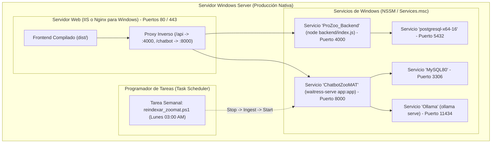

# Arquitectura y Contexto Técnico del Proyecto Pro_Zoo & Asistente Virtual ZooMAT
**Planificación para Despliegue Nativo en Windows Server (Sin Docker)**

> **Documento de Especificación Técnica y DevOps**  
> **Fecha de Elaboración:** Noviembre 2026  
> **Objetivo:** Documentar exhaustivamente la arquitectura, inventario de componentes, dependencias, flujo de red, almacenamiento, variables de entorno y estado del sistema para migrar de un despliegue basado en contenedores Docker hacia un entorno de producción nativo sobre **Windows Server** (ejecución mediante Servicios de Windows / NSSM y Tareas Programadas de Windows).

---

## 1. Árbol de Directorios y Estructura General

Estructura representativa del repositorio hasta 3 niveles de profundidad, excluyendo artefactos pesados o autogenerados (`node_modules/`, `venv/`, `.git/`, `__pycache__/`, `dist/`, `build/`, `chroma_db_zoomat/`):

```text
Pro_zoo/
├── .dockerignore
├── .env.example                               # Plantilla de variables de entorno para desarrollo
├── .env.production.example                    # Plantilla de variables de entorno para producción
├── .gitignore
├── CNAME                                      # Registro de dominio estático
├── Dockerfile                                 # Dockerfile raíz para Fly.io (servidor gostatic)
├── docker-compose.yml                         # Orquestación de 8 servicios Docker (referencia)
├── fly.toml                                   # Configuración de despliegue en Fly.io
├── package.json                               # Manifiesto raíz con dependencias de React y Express
├── package-lock.json
├── pnpm-workspace.yaml
├── README.md
├── README_INTEGRACION.md                      # Guía de integración de microfrontends (iframe)
│
├── backend/                                   # API REST en Node.js / Express
│   ├── app.js                                 # Configuración de Express, middlewares y rutas
│   ├── Dockerfile                             # Contenedor Node.js 20 Alpine
│   ├── generate-keys.sh                       # Script para generar claves seguras (OpenSSL)
│   ├── index.js                               # Punto de entrada HTTP y migración de BD
│   ├── config/
│   │   ├── db.js                              # Pool PostgreSQL y migraciones dinámicas (DDL)
│   │   └── env.js                             # Carga y validación de variables de entorno
│   ├── db/
│   │   ├── init.sql                           # Esquema inicial DDL de PostgreSQL
│   │   ├── seed.sql                           # Script de inicialización de datos base
│   │   └── seed-amphibians.sql
│   ├── routes/                                # Controladores y enrutamiento modular
│   │   ├── adminRoutes.js
│   │   ├── analyticsRoutes.js
│   │   ├── enclosureRoutes.js
│   │   ├── siteRoutes.js
│   │   ├── speciesRoutes.js
│   │   ├── ttsRoutes.js
│   │   └── uploadRoutes.js
│   ├── scripts/
│   │   └── createAdmin.js                     # Script interactivo para registrar superadmins
│   ├── services/
│   │   ├── audioService.js
│   │   └── hybridTtsService.js                # Síntesis TTS en backend (Edge-TTS / Google-TTS)
│   └── uploads/                               # Directorio persistente de multimedia subida
│
├── frontend/                                  # Aplicación Web React / TypeScript / Vite
│   ├── Dockerfile                             # Multi-stage build (Vite + Nginx)
│   ├── index.html                             # Plantilla HTML base del SPA
│   ├── nginx.conf                             # Configuración de proxy y rutas Nginx
│   ├── postcss.config.mjs
│   ├── tsconfig.json
│   ├── tsconfig.node.json
│   ├── vite.config.ts                         # Configuración Vite, middlewares dev y proxies
│   ├── public/                                # Recursos públicos estáticos
│   │   ├── favicon.ico
│   │   └── assets/                            # Cache TTS y uploads en dev
│   └── src/                                   # Código fuente del Frontend
│       ├── main.tsx                           # Montaje del Virtual DOM de React
│       ├── i18n.ts                            # Internacionalización i18next (ES / EN)
│       ├── app/
│       │   ├── App.tsx                        # Enrutador principal de la aplicación
│       │   ├── components/                    # Componentes UI reutilizables
│       │   │   ├── PublicChatButton.tsx       # Botón flotante y modal que embebe el Chatbot
│       │   │   ├── layout/                    # Header, Footer, Navigation
│       │   │   └── ...                        # Modales y componentes Radix UI
│       │   ├── context/                       # Estados globales (AuthContext, ZooContext)
│       │   ├── data/                          # Almacén local de datos base (zooStore)
│       │   ├── pages/                         # Vistas públicas (Home, Animals, Visit, etc.)
│       │   │   └── admin/                     # Panel CMS de administración (AdminAnimals, etc.)
│       │   └── services/                      # Consumo de API REST, TTS y analíticas
│
├── chatbot/                                   # Asistente Virtual Inteligente ZooMAT (Python)
│   ├── app.py                                 # Servidor Flask, lógica híbrida y endpoints
│   ├── Dockerfile                             # Contenedor Python 3.11-slim
│   ├── enrutador_semantico.py                 # Clasificador de intención NLP con spaCy
│   ├── GEMINI.md                              # Memoria técnica del asistente virtual
│   ├── ingesta_datos.py                       # Pipeline ETL y vectorización a ChromaDB
│   ├── motor_mysql.py                         # Consultas logísticas a MySQL y fallback
│   ├── motor_rag.py                           # Búsqueda vectorial semántica con ChromaDB
│   ├── requirements.txt                       # Dependencias de Python congeladas
│   ├── verificar_sistema.py                   # Suite de verificación de 39 pruebas de integración
│   ├── assets/                                # Audios estáticos y respuestas dinámicas
│   ├── logs/                                  # Bitácoras diarias de interacción (log_DD-MM-YYYY.txt)
│   ├── scheduler/                             # Automatización de reindexación en Docker
│   │   ├── crontab                            # Programación semanal de cron (Lunes 3:00 AM)
│   │   ├── Dockerfile                         # Contenedor Alpine con Docker CLI
│   │   └── ingestar_y_reiniciar.sh            # Script de orquestación de ingesta
│   ├── templates/
│   │   └── index.html                         # Interfaz web del Chatbot (kiosco e iframe)
│   ├── tests/                                 # Pruebas unitarias de regresión (pytest)
│   ├── chroma_db_zoomat/                      # [PERSISTENTE] Base de datos vectorial (SQLite + HNSW)
│   └── documentos_zoomat/                     # [ACERVO] 302 archivos biológicos e institucionales
│       └── (113 carpetas con fichas de fauna en formatos PDF, DOCX y TXT)
│
├── dist/                                      # [AUTOGENERADO] Salida de compilación del frontend
└── node_modules/                              # [AUTOGENERADO] Paquetes de Node.js
```

---

## 2. Inventario de Módulos / Subproyectos

### 2.1. Frontend Web (`frontend/`)
* **Ruta de la carpeta:** `frontend/` (orquestado desde la raíz con `package.json` y `frontend/vite.config.ts`).
* **Propósito y rol:** Portal web público institucional del ZooMAT para visitantes (información del parque, catálogo de fauna chiapaneca, horarios, servicios) y panel administrativo privado (CMS) para curadores de recintos y superadministradores. Aloja el botón flotante que embebe el chatbot.
* **Lenguaje, framework y runtime:** TypeScript 5+, React 18.3.1, Vite 6.4.4, Tailwind CSS v4.1.12, Lucide React, Radix UI primitives, Motion (Framer Motion).
* **Comandos de desarrollo y compilación:**
  * Desarrollo: `npm run dev` (ejecuta `vite --config frontend/vite.config.ts` en `http://localhost:5173`).
  * Compilación para producción: `npm run build` (genera el bundle estático optimizado en `dist/`).
* **Tipo de artefacto resultante:** Single Page Application (SPA) estática optimizada (HTML, JavaScript compilado, CSS minificado y assets estáticos) lista para ser servida por **Internet Information Services (IIS)** o Nginx.

### 2.2. Backend Web API (`backend/`)
* **Ruta de la carpeta:** `backend/`
* **Propósito y rol:** API RESTful que centraliza la lógica del portal web: autenticación mediante tokens JWT y contraseñas cifradas en Bcrypt para administradores, operaciones CRUD de especies y recintos, registro de auditorías administrativas, estadísticas de visitas y servicio de subida y lectura de archivos multimedia.
* **Lenguaje, framework y runtime:** Node.js 20+ (ES Modules), Express 4.21.2, cliente PostgreSQL `pg` 8.13.1, `cors`, `dotenv`, `nodemailer`.
* **Comandos de ejecución:**
  * Desarrollo / Producción: `npm run server` o `node backend/index.js`.
* **Tipo de artefacto resultante:** Servicio API REST en Node.js que expone endpoints JSON bajo el prefijo `/api` y sirve la carpeta de subidas bajo `/uploads`. En Windows Server se ejecuta como un **Servicio de Windows** (ej. mediante NSSM o PM2 para Windows).

### 2.3. Asistente Virtual / Chatbot (`chatbot/`)
* **Ruta de la carpeta:** `chatbot/`
* **Propósito y rol:** Agente conversacional híbrido por texto y voz optimizado para el zoológico. Responde consultas logísticas (tarifas, reglamentos, horarios, baños) desde MySQL/memoria y consultas de biodiversidad y fauna regional de Chiapas mediante ChromaDB y Llama 3.1. Funciona tanto en pantallas interactivas de kiosco como embebido dentro del sitio web.
* **Lenguaje, framework y runtime:** Python 3.12 (entorno virtual `venv`), Flask 3.1.3, Flask-Cors 5.0.1, spaCy 3.8.13 (`es_core_news_sm`), LangChain 1.2+, ChromaDB 1.5.7, Hugging Face Transformers (`paraphrase-multilingual-MiniLM-L12-v2`), Edge-TTS 7.3.1 / gTTS 2.5.4, MySQL Connector Python 9.6.0.
* **Comandos de ejecución y pruebas:**
  * Ejecución estándar: `python app.py` (puerto configurable mediante `CHATBOT_PORT`, por defecto `8000`).
  * Pre-renderizado de audios rápidos: `python app.py --regenerar-audios`.
  * Verificación integral: `python verificar_sistema.py` (39 pruebas automáticas) o `pytest -v` (32 pruebas unitarias).
* **Tipo de artefacto resultante:** Aplicación web WSGI en Python que sirve la interfaz interactiva en `GET /` y el motor conversacional en `POST /chat`. Para producción en Windows Server se debe ejecutar sobre **Waitress WSGI** registrado como Servicio de Windows.

### 2.4. Motor de Ingesta y Vectorización RAG (`chatbot/ingesta_datos.py`)
* **Ruta del archivo:** `chatbot/ingesta_datos.py`
* **Propósito y rol:** Pipeline ETL autónomo que escanea el acervo de documentos oficiales en `chatbot/documentos_zoomat/` (fichas biológicas de especies nativas e historia del zoológico), extrae texto de PDF, DOCX y TXT, asigna metadatos biológicos estandarizados, genera representaciones vectoriales densas con MiniLM-L12-v2 y reconstruye el almacén vectorial ChromaDB.
* **Lenguaje y runtime:** Python 3.12 CLI / standalone.
* **Comando de ejecución:** `python ingesta_datos.py` (dentro del entorno `venv` del chatbot).
* **Tipo de artefacto resultante:** Base de datos vectorial persistida en disco en `chatbot/chroma_db_zoomat/` (base de metadatos `chroma.sqlite3` y carpetas de índices binarios HNSW).

### 2.5. Motor de LLM Local (Ollama)
* **Ruta de instalación:** Fuera del repositorio, a nivel de sistema operativo (`C:\Users\<Usuario>\AppData\Local\Programs\Ollama\ollama.exe` o servicio de sistema).
* **Propósito y rol:** Servidor de inferencia local para el modelo de lenguaje de código abierto **`llama3.1:latest`** (Llama 3.1 8B Instruct). Opera de forma totalmente privada y sin conexión a internet externa para síntesis y estructuración de respuestas sobre la fauna regional.
* **Runtime:** Daemon en Go/C++ de Ollama.
* **Comandos de control:** `ollama serve` (inicia el daemon), `ollama pull llama3.1` (descarga el modelo oficial de ~4.7 GB).
* **Tipo de artefacto resultante:** Servidor HTTP local escuchando en `http://localhost:11434` que expone la API REST `/api/generate`.

### 2.6. Tarea de Reindexación Periódica (Programador / Scheduler)
* **Ruta original en Docker:** `chatbot/scheduler/` (`Dockerfile`, `crontab`, `ingestar_y_reiniciar.sh`).
* **Propósito y rol:** Automatizar la reindexación de nuevos documentos que los biólogos o administradores depositen en `documentos_zoomat/`. En el entorno original de contenedores, un cron ejecutaba la ingesta los lunes a las 3:00 AM y reiniciaba el contenedor del chatbot.
* **Equivalente para Windows Server:** Tarea programada nativa de Windows (**Task Scheduler**) que ejecuta un script de PowerShell (`reindexar_zoomat.ps1`) para orquestar la parada del servicio, ejecución de `ingesta_datos.py` y reactivación del servicio.

---

## 3. Dependencias Exactas (Página Web y Chatbot)

### 3.1. Frontend y Backend Web (`package.json`)
El proyecto web opera con un manifiesto unificado en la raíz:

* **Scripts definidos:**
  * `"dev": "vite --config frontend/vite.config.ts"`
  * `"build": "vite build --config frontend/vite.config.ts"`
  * `"server": "node backend/index.js"`

* **Dependencias de Producción (`dependencies`):**
  * **Core Web & UI:** `react` 18.3.1, `react-dom` 18.3.1, `react-router` ^7.18.4, `lucide-react` 0.487.0, `clsx` 2.1.1, `tailwind-merge` 3.2.0, `motion` 12.23.24, `next-themes` 0.4.6, `sonner` 2.0.3.
  * **Componentes Radix UI:** `@radix-ui/react-accordion` 1.2.3, `@radix-ui/react-dialog` 1.1.6, `@radix-ui/react-dropdown-menu` 2.1.6, `@radix-ui/react-tabs` 1.1.3, `@radix-ui/react-select` 2.1.6, etc.
  * **MUI (Material UI):** `@mui/material` 7.3.5, `@mui/icons-material` 7.3.5, `@emotion/react` 11.14.0, `@emotion/styled` 11.14.1.
  * **Internacionalización:** `i18next` ^26.2.0, `react-i18next` ^17.0.8.
  * **Servidor Backend (Express):** `express` ^4.21.2, `cors` ^2.8.5, `dotenv` ^16.5.0, `pg` ^8.13.1 (PostgreSQL), `bcrypt` ^6.0.0, `jsonwebtoken` ^9.0.2, `nodemailer` ^10.1.1.
  * **Síntesis de Voz e Imágenes:** `node-edge-tts` ^1.2.12, `google-tts-api` ^2.0.2, `qrcode` ^1.5.4, `jspdf` ^4.2.1.

* **Dependencias de Desarrollo (`devDependencies`):**
  * `vite` ^6.4.4 (con override pnpm a 6.3.5).
  * `@vitejs/plugin-react` 4.7.0.
  * `tailwindcss` 4.1.12 y `@tailwindcss/vite` 4.1.12.

### 3.2. Asistente Virtual Chatbot (`chatbot/requirements.txt`)
Dependencias clave de Python (probadas y congeladas bajo **Python 3.12 64-bit**):

| Módulo / Paquete | Versión Exacta | Rol en el Sistema |
| :--- | :--- | :--- |
| `Flask` | 3.1.3 | Framework web principal del chatbot (routing y endpoints HTTP) |
| `Flask-Cors` | 5.0.1 | Habilitación de peticiones CORS desde orígenes web externos |
| `chromadb` | 1.5.7 | Base de datos vectorial embebida y cliente HTTP |
| `langchain` / `langchain-chroma` | 1.2.15 / 1.1.0 | Integración RAG, embeddings y gestión de almacén vectorial |
| `langchain-huggingface` | 1.2.2 | Puentes para generación de embeddings locales |
| `sentence-transformers` | 5.4.1 | Modelo semántico `paraphrase-multilingual-MiniLM-L12-v2` |
| `torch` | 2.11.0 | Motor de cálculo tensorial para Hugging Face / Transformers |
| `spacy` | 3.8.13 | Procesamiento de lenguaje natural y lematización |
| `es_core_news_sm` | 3.8.0 | Modelo de lenguaje de spaCy en español |
| `mysql-connector-python` | 9.6.0 | Conector nativo de Python para base de datos MySQL |
| `edge-tts` | 7.3.1 | Motor principal de síntesis de voz neuronal (Microsoft Edge TTS) |
| `gTTS` | 2.5.4 | Motor secundario de síntesis de voz (Google Text-to-Speech) |
| `pypdf` / `docx2txt` | 6.10.2 / 0.9 | Extractores de texto para documentos PDF y DOCX en la ingesta |
| `pytest` | 9.1.1 | Suite de pruebas unitarias automatizadas |

### 3.3. Requisitos de Sistema Operativo para Windows Server
Para ejecutar el stack completo sin contenedores en Windows Server se requieren los siguientes componentes del sistema:

1. **Python 3.12 (64-bit):** Instalado en `C:\Python312` con la opción *"Add Python to PATH"* habilitada.
2. **Node.js LTS (v20 o superior):** Instalado con `npm` y `npx` accesibles en el `PATH` del sistema.
3. **Microsoft Visual C++ 2015-2022 Redistributable (x64):** Requisito indispensable para `torch`, `sentence-transformers`, `spacy` y extensiones binarias de Python en Windows.
4. **Build Tools para Visual Studio (C++ x64/x86 build tools):** Necesario si se recompilan módulos nativos de Python o Node.js.
5. **Ollama para Windows:** Instalado como aplicación o servicio en Windows Server.
6. **PostgreSQL Server 16+ para Windows:** Servicio del sistema configurado para arrancar automáticamente (`postgresql-x64-16`).
7. **MySQL Server 8.0+ para Windows:** Servicio del sistema configurado para arrancar automáticamente (`MySQL80`).
8. **Waitress (Paquete Python WSGI):** Debe instalarse en el `venv` del chatbot (`pip install waitress`) para sustituir el servidor de desarrollo de Flask en Windows.

---

## 4. Comunicación entre Servicios, Puertos y URLs

### 4.1. Mapeo de Puertos (Desarrollo vs Producción)

| Servicio / Componente | Puerto en Desarrollo | Puerto en Producción Docker | Puerto Propuesto Windows Server Nativo |
| :--- | :---: | :---: | :---: |
| **Frontend Web (React)** | `5173` (Vite dev) | `80` (Nginx) | `80` / `443` (IIS o Nginx para Windows) |
| **Backend API (Node.js Express)**| `4000` | `3001` | `4000` (Servicio de Windows Node.js) |
| **Chatbot ZooMAT (Flask / Waitress)**| `8000` | `8000` (mapeado de 5000) | `8000` (Servicio de Windows Waitress) |
| **PostgreSQL Database (Pro_Zoo)** | `5432` | `5432` | `5432` (Servicio nativo PostgreSQL) |
| **MySQL Database (Logística Chatbot)**| `3306` | `3306` | `3306` (Servicio nativo MySQL) |
| **ChromaDB Vectorial** | Embebido en disco | `8001:8000` | Embebido local (`./chroma_db_zoomat`) |
| **Ollama LLM (Llama 3.1)** | `11434` | `11434` | `11434` (Ollama daemon local) |

### 4.2. Integración del Chatbot vía Microfrontend (`<iframe>`)
El Asistente Virtual no está acoplado al código compilado de React; se carga mediante un microfrontend aislado dentro del componente React `frontend/src/app/components/PublicChatButton.tsx`.

* **Instanciación:**
  ```tsx
  <iframe
    src={CHATBOT_URL}
    width="100%"
    height="100%"
    frameBorder="0"
    style={{ border: "none", borderRadius: "inherit" }}
    allow="microphone"
    title="Asistente Virtual ZooMAT"
    className="w-full h-full block"
  />
  ```
* **Lazy Loading y Persistencia en Memoria:** El componente utiliza la bandera `hasOpened`. El `<iframe>` solo se añade al DOM la primera vez que el visitante hace clic en el botón flotante dorado; cuando el modal se minimiza o cierra, permanece montado en segundo plano para no destruir el hilo de conversación ni el estado de audio.
* **Comunicación Cruzada por Eventos (`postMessage`):**
  * La plantilla del chatbot (`chatbot/templates/index.html`) detecta si corre dentro de un frame (`window.self !== window.top`).
  * Al pulsar el botón de cerrar en el encabezado del chatbot, despacha:
    ```javascript
    window.parent.postMessage({ type: 'ZOOMAT_CHAT_CLOSE' }, '*');
    ```
  * `PublicChatButton.tsx` escucha este evento en un `window.addEventListener('message', ...)` y conmuta el estado React `setIsOpen(false)`.
* **Permiso Crítico de Hardware (`allow="microphone"`):** Es obligatorio declarar `allow="microphone"` en el tag `<iframe>`. De lo contrario, las políticas de seguridad de Chrome, Edge y Firefox bloquearán la `Web Speech API` arrojando un error de seguridad `NotAllowedError`.

### 4.3. Variables de Entorno del Frontend (`VITE_*`)
* `VITE_API_BASE_URL`: Especifica el origen HTTP de la API de Node.js Express.
  * Si está definida (ej. `http://localhost:4000` o `https://api.pruzo.me`), todas las llamadas de `ZooContext`, `AuthContext` y servicios apuntan a esa URL.
  * Si se deja vacía (`""`), las peticiones usan rutas relativas (ej. `/api/species`), requiriendo que el servidor web inverso (IIS o Nginx) reenvíe las rutas `/api` al backend.
* `VITE_CHATBOT_URL`: Especifica el origen del chatbot para el `src` del iframe.
  * Por defecto: `http://localhost:8000` (desarrollo) o `https://chatbot.pruzo.me` (producción).

### 4.4. Referencias y URLs en el Código Fuente

| Archivo | Línea | URL / Expresión Encontrada | Propósito / Comportamiento |
| :--- | :---: | :--- | :--- |
| `frontend/src/app/components/PublicChatButton.tsx` | 5-7 | `import.meta.env.VITE_CHATBOT_URL \|\| (PROD ? "https://chatbot.pruzo.me" : "http://localhost:8000")` | URL del iframe del chatbot con fallback automático según entorno |
| `frontend/vite.config.ts` | 189-198 | `proxy: { '/api': 'http://127.0.0.1:4000', '/uploads': 'http://127.0.0.1:4000' }` | Proxy inverso del servidor de desarrollo Vite hacia Express |
| `frontend/nginx.conf` | 13-17 | `proxy_pass http://backend:3001;` | Proxy inverso Nginx en Docker hacia la API Node |
| `frontend/nginx.conf` | 20-24 | `proxy_pass http://chatbot:8000/;` | Proxy inverso Nginx en Docker hacia el Chatbot |
| `backend/config/env.js` | 7 | `Number(process.env.PORT \|\| 4000)` | Puerto de escucha predeterminado de la API REST |
| `backend/config/env.js` | 27 | `process.env.PUBLIC_APP_URL \|\| 'https://pruzo.me'` | Dominio público del portal para enlaces y correos |
| `chatbot/app.py` | 28-29 | `os.getenv("CORS_ORIGINS", "*")` | Orígenes autorizados en Flask-CORS |
| `chatbot/app.py` | 46-48 | `f"http://{OLLAMA_HOST}:{OLLAMA_PORT}/api/generate"` | Endpoint de inferencia del LLM Llama 3.1 |
| `chatbot/app.py` | 2108-2109| `app.run(host='0.0.0.0', port=port, debug=debug)` | Inicialización del servidor Flask en el puerto `8000` |

### 4.5. Políticas de Seguridad Web (CORS, CSP y Frame-Ancestors)
En un despliegue en Windows Server, la aplicación web y el chatbot operarán en diferentes puertos (`80`/`443` vs `8000`) o en subdominios independientes (ej. `pruzo.me` y `chatbot.pruzo.me`). Deben respetarse las siguientes directivas:

1. **CORS (Cross-Origin Resource Sharing):**
   * Backend Express: Controlado por `CORS_ORIGIN` en `backend/config/env.js`. Si se despliega en producción, debe contener el dominio del frontend: `https://pruzo.me,https://www.pruzo.me`.
   * Chatbot Flask: Controlado por `CORS_ORIGINS` en `chatbot/app.py`. Debe incluir los dominios permitidos o `*`.
2. **Inclusión en Iframe (`frame-ancestors` vs `X-Frame-Options`):**
   * El asistente virtual debe permitir ser embebido en el frontend. Si IIS o Nginx agregan por defecto la cabecera `X-Frame-Options: SAMEORIGIN` o `X-Frame-Options: DENY`, el navegador **bloqueará de inmediato la carga del chatbot**.
   * **Regla estricta:** El servicio que sirva el Chatbot en el puerto `8000` (o subdominio) debe omitir `X-Frame-Options` o configurarlo con `Content-Security-Policy: frame-ancestors 'self' https://pruzo.me http://localhost:*`.
3. **Aislamiento de Recursos en Frontend (`COEP` / `COOP`):**
   * En `frontend/vite.config.ts` se observan directivas `Cross-Origin-Embedder-Policy: require-corp` y `Cross-Origin-Opener-Policy: same-origin`.
   * En un servidor de producción (IIS/Nginx), no se debe imponer `COEP: require-corp` en el HTML principal a menos que el chatbot devuelva cabeceras `Cross-Origin-Resource-Policy: cross-origin`, ya que de lo contrario el navegador impedirá incrustar el frame.

---

## 5. Mapa de Variables de Entorno (Sin Secretos)

> [!IMPORTANT]
> Por directriz estricta de seguridad, este inventario no contiene credenciales reales. Todos los valores sensibles muestran marcadores de posición estandarizados `<REDACTADO>`.

| Variable de Entorno | Componente Consumidor | Propósito Funcional | Valor por Defecto | Ejemplo Seguro para Producción |
| :--- | :--- | :--- | :--- | :--- |
| `VITE_API_BASE_URL` | Frontend React | URL base para consumo de endpoints REST | `""` (rutas relativas) | `https://api.pruzo.me` |
| `VITE_CHATBOT_URL` | Frontend React | URL embebida en el iframe del modal | `http://localhost:8000` | `https://chatbot.pruzo.me` |
| `VITE_ADMIN_API_KEY` | Frontend React | Clave de cabecera para acciones de admin | `zoomat-admin-key` | `<REDACTADO_32_BYTES_HEX>` |
| `PORT` | Backend Node.js | Puerto TCP de escucha de Express | `4000` | `4000` |
| `POSTGRES_HOST` | Backend Node.js | Host del motor de base de datos PostgreSQL | `localhost` | `localhost` o `127.0.0.1` |
| `POSTGRES_PORT` | Backend Node.js | Puerto TCP de PostgreSQL | `5432` | `5432` |
| `POSTGRES_USER` | Backend Node.js | Usuario autenticado en PostgreSQL | `postgres` | `usr_prozoo_admin` |
| `POSTGRES_PASSWORD` | Backend Node.js | Contraseña de usuario PostgreSQL | `postgres` | `<REDACTADO_PASSWORD>` |
| `POSTGRES_DATABASE` | Backend Node.js | Nombre de la base de datos de la web | `pro_zoo` | `pro_zoo` |
| `POSTGRES_SSL` | Backend Node.js | Conexión SSL/TLS con PostgreSQL | `false` | `false` (local) o `true` (remoto) |
| `ADMIN_API_KEY` | Backend Node.js | Token estático de autorización de APIs | `zoomat-admin-key` | `<REDACTADO_API_KEY>` |
| `CORS_ORIGIN` | Backend Node.js | Orígenes web autorizados (CORS) | `*` | `https://pruzo.me` |
| `JWT_SECRET` | Backend Node.js | Clave simétrica para firma de tokens JWT | `super-secret-key-2026` | `<REDACTADO_JWT_SECRET>` |
| `SMTP_HOST` | Backend Node.js | Servidor SMTP para envío de correos | `smtp.gmail.com` | `smtp.gmail.com` |
| `SMTP_PORT` | Backend Node.js | Puerto del servidor SMTP | `465` | `465` |
| `SMTP_SECURE` | Backend Node.js | Uso de SSL directo en SMTP | `true` | `true` |
| `SMTP_USER` | Backend Node.js | Usuario/correo del emisor SMTP | `""` | `notificaciones@zoomat.gob.mx` |
| `SMTP_PASSWORD` | Backend Node.js | Contraseña o token de aplicación SMTP | `""` | `<REDACTADO_APP_PASSWORD>` |
| `MAIL_FROM` | Backend Node.js | Remitente visible en correos enviados | `""` | `ZooMAT Oficial <noreply@zoomat.gob.mx>` |
| `PUBLIC_APP_URL` | Backend Node.js | Enlace base público para links de correo | `https://pruzo.me` | `https://pruzo.me` |
| `TRANSLATION_API_URL` | Backend Node.js | Endpoint para traducción automática | `api.mymemory.translated.net`| `https://api.mymemory.translated.net/get` |
| `UPLOAD_DIR` | Backend Node.js | Ruta de almacenamiento de archivos subidos | `./uploads` | `C:\Pro_Zoo\backend\uploads` |
| `CHATBOT_PORT` | Chatbot Flask | Puerto TCP de escucha del Chatbot | `8000` | `8000` |
| `CHATBOT_DEBUG` | Chatbot Flask | Modo depuración de Flask | `False` | `False` |
| `CORS_ORIGINS` | Chatbot Flask | Lista de dominios permitidos para el bot | `*` | `https://pruzo.me,http://localhost:5173` |
| `INGEST_SECRET` | Chatbot Flask | Clave secreta para endpoint `/ingestar` | `mi_clave_ingesta_secreta` | `<REDACTADO_SECRET>` |
| `OLLAMA_HOST` | Chatbot Flask | Dirección IP o host del daemon de Ollama | `localhost` | `127.0.0.1` |
| `OLLAMA_PORT` | Chatbot Flask | Puerto TCP de la API de Ollama | `11434` | `11434` |
| `CHROMA_HOST` | Chatbot Flask | Host de ChromaDB (si opera en modo cliente) | `None` (usa SQLite local) | *(dejar vacío para persistencia local)* |
| `CHROMA_PORT` | Chatbot Flask | Puerto de ChromaDB en modo cliente | `8000` | `8000` |
| `DB_HOST` / `MYSQL_HOST` | Chatbot Flask | Host del motor de base de datos MySQL | `localhost` | `localhost` o `127.0.0.1` |
| `DB_PORT` / `MYSQL_PORT` | Chatbot Flask | Puerto TCP del motor MySQL | `3306` | `3306` |
| `DB_USER` / `MYSQL_USER` | Chatbot Flask | Usuario de conexión a MySQL | `root` | `usr_zoomat_bot` |
| `DB_PASS` / `MYSQL_PASSWORD` | Chatbot Flask | Contraseña de conexión a MySQL | `""` | `<REDACTADO_MYSQL_PASSWORD>` |
| `DB_NAME` / `MYSQL_DATABASE` | Chatbot Flask | Base de datos de logística del chatbot | `zoomat_db` | `zoomat_db` |

---

## 6. Bases de Datos, Almacenamiento y Persistencia

### 6.1. Base de Datos Relacional PostgreSQL (`pro_zoo`)
* **Propósito:** Gestión de contenidos del portal web, catálogo científico de especies y control de acceso administrativo.
* **Mecanismo de Inicialización:**
  * Script inicial: `backend/db/init.sql`.
  * Migraciones y sincronización DDL automática en caliente: La función `ensureDatabaseSchema()` en `backend/config/db.js` se ejecuta cada vez que el backend de Node.js arranca, verificando y creando automáticamente las columnas o tablas faltantes mediante sentencias `ALTER TABLE ... ADD COLUMN IF NOT EXISTS`.
* **Tablas Principales:**
  1. `species`: Catálogo de animales (nombre común, científico, descripción, hábitat, dieta, taxonomía completa en JSONB, estatus de conservación UICN, arreglos de imágenes/videos en JSONB y enlaces de videos LSM).
  2. `enclosures`: Módulos o recintos del zoológico (Aviario, Felinos, Vivario, etc.).
  3. `admin_users`: Cuentas de superadministradores y curadores de recintos (contraseñas en hash Bcrypt con factor de costo 12).
  4. `site_content`: Estructuras de contenido editorial dinámico del portal.
  5. `password_reset_tokens`: Tokens criptográficos temporales con fecha de expiración para recuperación de contraseña.
  6. `species_visits`: Registro analítico disociado de visitas para métricas de popularidad.
  7. `admin_audit_logs`: Trazabilidad y bitácora de auditoría de cada modificación realizada en el panel CMS.
* **Persistencia de Archivos y Multimedia:**
  * Almacenamiento local en disco en `backend/uploads/` (imágenes de fichas, audios generados y documentos).
  * Servido a la web como recurso estático bajo la ruta URL `/uploads/*`.

### 6.2. Base de Datos Relacional MySQL (`zoomat_db`)
* **Propósito:** Almacén oficial de logística operativa, precios, horarios, ubicaciones y normativas del ZooMAT para el chatbot.
* **Tabla Principal:**
  ```sql
  CREATE TABLE IF NOT EXISTS servicios_logistica (
      id INT AUTO_INCREMENT PRIMARY KEY,
      entidad VARCHAR(50) NOT NULL,
      tipo_informacion VARCHAR(50) NOT NULL,
      valor TEXT NOT NULL,
      UNIQUE KEY unica_entidad_tipo (entidad, tipo_informacion)
  );
  ```
* **Mecanismo de Persistencia y Carga:**
  * El módulo `motor_mysql.py` contiene la definición canónica de 28 registros oficiales (categorías: `horario`, `boleto`, `servicio`, `regla`, `ubicacion`).
  * En cada arranque o consulta, ejecuta sentencias idempotentes `INSERT ... ON DUPLICATE KEY UPDATE` asegurando que los datos de taquilla siempre coincidan con las directrices de la jefatura.
  * **Tolerancia a Fallos (Respaldo en Memoria):** Si el servicio local de MySQL estuviese temporalmente inactivo o detenido por mantenimiento, `motor_mysql.py` conmuta automáticamente y sin lanzar excepciones al diccionario estático `DATOS_LOGISTICA_MEMORIA`.

### 6.3. Base de Datos Vectorial ChromaDB (`chroma_db_zoomat`)
* **Ubicación en Disco:** `chatbot/chroma_db_zoomat/`
* **Arquitectura de Persistencia:** Embebida en proceso mediante `langchain_chroma.Chroma`.
* **Estructura Interna en Disco:**
  * `chroma.sqlite3`: Base de datos SQLite transaccional que contiene los metadatos de los documentos, textos completos y mapeo de IDs.
  * Subcarpetas UUID: Archivos binarios (`data_level0.bin`, `header.bin`, `length.bin`) que contienen los grafos de búsqueda aproximada por vecinos más cercanos (**HNSW - Hierarchical Navigable Small World**).
* **Colección y Parámetros Semánticos:**
  * Modelo de Embeddings: `paraphrase-multilingual-MiniLM-L12-v2` (384 dimensiones densas).
  * 329 fragmentos vectorizados que indexan las 8 clases biológicas nativas de Chiapas más la historia del ZooMAT.
  * Búsqueda por Mapeo de Máxima Relevancia Marginal (MMR): `k=4`, `fetch_k=10`, `lambda_mult=0.7`.

### 6.4. Archivos Estáticos, Audios y Bitácoras
* **Audios Rápidos Pre-renderizados (`chatbot/assets/`):**
  * Archivos fijos: `costos.mp3`, `costos_en.mp3`, `horarios.mp3`, `horarios_en.mp3`, `banos.mp3`, `banos_en.mp3`.
  * Se sirven directamente desde el fast-path con latencia `< 0.01s`.
* **Audios Dinámicos de Respuesta:**
  * Generados por `edge-tts` (voz `es-MX-JorgeNeural` o `en-US-GuyNeural`) con respaldo en `gTTS`.
  * Archivos destino actuales: `chatbot/assets/respuesta.mp3` y `chatbot/assets/respuesta_en.mp3`.
* **Bitácoras Diarias de Auditoría (`chatbot/logs/`):**
  * Archivo continuo por fecha: `chatbot/logs/log_DD-MM-YYYY.txt`.
  * Registra en modo *append* (`a`) cada consulta de visitante, respuesta emitida, idioma y tiempo de respuesta en segundos sin destruir registros previos.

---

## 7. Archivos de Docker, Despliegue o Scripts Ya Existentes

El repositorio cuenta con configuraciones para despliegue en contenedores que sirven como mapa de referencia para trasladar sus especificaciones a Windows Server nativo:

### 7.1. `docker-compose.yml` (Mapa de 8 Servicios)
1. **`postgres` (`postgres:16-alpine`):** Expone puerto `5432`, monta datos en volumen `postgres_data`, inicializa con `backend/db/init.sql`.
2. **`mysql` (`mysql:8.0`):** Expone puerto `3306`, base de datos `chatbot_zoo`, datos en volumen `mysql_data`.
3. **`chromadb` (`chromadb/chroma:latest`):** Expone puerto `8001:8000`, volumen `chroma_data`.
4. **`backend` (Node.js Express):** Compilado desde `backend/Dockerfile`, expone puerto `3001`, monta `uploads_data` en `/app/uploads`.
5. **`chatbot` (Python Flask):** Compilado desde `chatbot/Dockerfile`, expone puerto `8000`, enlaza `documentos_zoomat/` y persiste `chroma_db_local`.
6. **`ollama` (`ollama/ollama:latest`):** Expone puerto `11434`, monta `ollama_data` y descarga automáticamente `llama3.1`.
7. **`frontend` (React + Nginx):** Compilado con Vite bajo variables de build `VITE_API_BASE_URL` y `VITE_CHATBOT_URL`, servido en puerto `80`.
8. **`scheduler` (Alpine cron):** Contenedor auxiliar con acceso al socket de Docker que ejecuta `ingestar_y_reiniciar.sh` los lunes a las 3:00 AM.

### 7.2. Dockerfiles de los Componentes
* **`frontend/Dockerfile`:** Construcción multi-etapa. Etapa 1 (`node:20-alpine`) ejecuta `npm run build`; Etapa 2 (`nginx:alpine`) copia `dist/` a `/usr/share/nginx/html` y aplica `nginx.conf`.
* **`frontend/nginx.conf`:** Enruta el tráfico raíz a React SPA (`try_files $uri /index.html`), mientras que redirige peticiones `/api/` hacia el backend en el puerto `3001` y `/chatbot/` hacia el puerto `8000`.
* **`backend/Dockerfile`:** Imagen ligera en `node:20-alpine`, instala dependencias con `npm install --production` y ejecuta `node index.js`.
* **`chatbot/Dockerfile`:** Imagen en `python:3.11-slim`, instala `requirements.txt` y arranca con `python app.py`.
* **`chatbot/scheduler/Dockerfile` y `ingestar_y_reiniciar.sh`:** Imagen Alpine con cliente Docker y cron que ejecuta `docker exec prozoo_chatbot python ingesta_datos.py` seguido de `docker restart prozoo_chatbot`.
* **`Dockerfile` (raíz) y `fly.toml`:** Configuración original para la plataforma Fly.io usando un binario `gostatic` en el puerto 8080 con 2 GB de memoria RAM.
* **`backend/generate-keys.sh`:** Script en bash que invoca OpenSSL para imprimir cadenas aleatorias seguras de 32 bytes para `ADMIN_API_KEY` y `JWT_SECRET`.
* **`backend/scripts/createAdmin.js`:** Script de terminal en Node.js que solicita interactivamente nombre, correo y contraseña para dar de alta al primer usuario en `admin_users`.

---

## 8. Estado Técnico del Chatbot para Producción en Windows Server

### 8.1. Diagnóstico del Servidor Actual del Chatbot (`app.py`)
En el archivo `chatbot/app.py`, el bloque de ejecución principal está configurado de la siguiente forma:

```python
if __name__ == '__main__':
    if len(sys.argv) > 1 and sys.argv[1] == '--regenerar-audios':
        regenerar_audios_estaticos()
    else:
        debug = os.getenv('CHATBOT_DEBUG', '').lower() in {'1', 'true', 'yes'}
        port = int(os.getenv('CHATBOT_PORT', 8000))
        app.run(host='0.0.0.0', port=port, debug=debug)
```

* **Limitaciones para Producción:** `app.run()` invoca el servidor de desarrollo interno de Werkzeug. En Windows Server, este servidor:
  1. No está optimizado para concurrencia ni para colas de conexiones HTTP bajo demanda real.
  2. Es susceptible a bloqueos si una petición de audio o inferencia LLM retiene el hilo de atención.
  3. Muestra explícitamente la advertencia: *"WARNING: This is a development server. Do not use it in a production deployment"*.

### 8.2. Requerimientos para Servir el Chatbot con Waitress en Windows Server
Dado que servidores WSGI estándar de Linux como **Gunicorn** o **uWSGI** dependen de primitivas POSIX (`fork()`, señales Unix y descriptores de archivo) inexistentes en Windows, **Waitress** es el servidor WSGI de producción recomendado oficialmente por el equipo de Pallets (Flask) y Microsoft para entornos Windows.

* **Instalación:**
  ```powershell
  pip install waitress
  ```
* **Comando de Ejecución para Producción:**
  ```powershell
  waitress-serve --host=0.0.0.0 --port=8000 --threads=8 app:app
  ```
* **O mediante un script wrapper `server.py`:**
  ```python
  import os
  from waitress import serve
  from app import app

  if __name__ == '__main__':
      port = int(os.getenv('CHATBOT_PORT', 8000))
      threads = int(os.getenv('WAITRESS_THREADS', 8))
      print(f"Iniciando Asistente Virtual ZooMAT en Waitress WSGI (Puerto: {port}, Hilos: {threads})...")
      serve(app, host='0.0.0.0', port=port, threads=threads)
  ```
* **Manejo de Concurrencia y Memoria Compartida:**
  * Los módulos de NLP (`motor_rag.py`, `enrutador_semantico.py` con spaCy y `motor_mysql.py`) cargan sus modelos y diccionarios a nivel de módulo (`module-level scope`).
  * En una arquitectura multi-hilo como Waitress en Windows, todos los hilos comparten el mismo proceso y la misma memoria RAM, permitiendo atender hasta 8 o 16 peticiones simultáneas consumiendo únicamente **~1.2 GB de RAM** en total para los modelos lingüísticos, sin duplicar memoria.

### 8.3. Riesgo Crítico de Concurrencia: Sobreescritura y Bloqueo de Audios
* **Problema Identificado:** En `chatbot/app.py` (línea 2085), las respuestas dinámicas de voz se guardan bajo nombres de archivo fijos:
  ```python
  nombre_audio = f"respuesta_{idioma}.mp3" if idioma == 'en' else "respuesta.mp3"
  ```
* **Consecuencias en Producción:**
  1. Si dos visitantes preguntan simultáneamente en el kiosco o en la web, se generará una condición de carrera donde el Audio del Visitante B sobrescribirá el del Visitante A mientras este aún lo descarga.
  2. En Windows NTFS, si IIS o un navegador mantiene abierta la conexión de lectura sobre `assets/respuesta.mp3`, la llamada de escritura de `edge-tts` fallará arrojando un error fatal:
     `PermissionError: [WinError 32] El proceso no tiene acceso al archivo porque está siendo utilizado por otro proceso`.
* **Solución Técnica:** En un despliegue multi-usuario en producción se debe parametrizar la generación de audios utilizando identificadores únicos (UUID o hash) con limpieza periódica:
  ```python
  import uuid
  nombre_audio = f"resp_{uuid.uuid4().hex[:10]}_{idioma}.mp3"
  ```

### 8.4. Tiempo de Ejecución y Requisitos de `ingesta_datos.py`
* **Volumen del Acervo:** 302 documentos (PDF, DOCX, TXT) contenidos en 113 carpetas dentro de `chatbot/documentos_zoomat/`.
* **Tiempo Estimado de Ejecución:**
  * En CPU moderna (Intel Xeon o Core i7/i9 con 4 a 8 núcleos): **entre 2.5 y 5 minutos**.
  * En GPU con aceleración CUDA: **< 45 segundos**.
* **Requisitos de Recursos durante la Ingesta:**
  * **Memoria RAM:** Pico de **1.8 GB a 2.5 GB** durante la vectorización por lotes de PyTorch con el modelo `paraphrase-multilingual-MiniLM-L12-v2`.
  * **Uso de CPU:** Saturación del 80% al 100% en los núcleos de cálculo mientras se calculan los embeddings densos.

### 8.5. Riesgo Crítico en Windows NTFS: Bloqueo de Archivos SQLite / ChromaDB
* **Causa Raíz:** En las líneas 609-614 de `chatbot/ingesta_datos.py`, el proceso de indexación ejecuta:
  ```python
  if os.path.exists(RUTA_BASE_DATOS):
      shutil.rmtree(RUTA_BASE_DATOS, ignore_errors=True)
  ```
* **Diferencia Crítica Linux vs Windows:**
  * En Linux (Docker), el kernel permite eliminar (`unlink`) descriptores de archivos abiertos; el proceso que lee continúa con el inodo viejo hasta que se reinicia.
  * En **Windows Server (NTFS)**, el motor SQLite de ChromaDB (`chroma.sqlite3`) mantiene un bloqueo de archivo exclusivo a nivel de sistema operativo (`exclusive file lock`).
  * Si la Tarea Programada de Windows ejecuta `python ingesta_datos.py` mientras el servicio del Chatbot (Waitress) está encendido y atendiendo peticiones, `shutil.rmtree()` **fallará inmediatamente con `PermissionError: [WinError 32]`**.
* **Estrategia Obligatoria para la Tarea Programada en Windows Server:**
  El script de automatización (`reindexar_zoomat.ps1`) en el Programador de Tareas de Windows debe orquestar el ciclo de vida del servicio:
  ```powershell
  # reindexar_zoomat.ps1
  Write-Output "[1/3] Deteniendo servicio del Chatbot..."
  Stop-Service -Name "ChatbotZooMAT" -Force

  Write-Output "[2/3] Ejecutando ingesta de documentos..."
  & "C:\Pro_Zoo\chatbot\venv\Scripts\python.exe" "C:\Pro_Zoo\chatbot\ingesta_datos.py"

  Write-Output "[3/3] Reiniciando servicio del Chatbot..."
  Start-Service -Name "ChatbotZooMAT"
  Write-Output "Proceso de reindexación finalizado exitosamente."
  ```

---

## 9. Resumen Ejecutivo para la Migración a Windows Server

Para consolidar la infraestructura nativa en Windows Server sin Docker, la arquitectura quedará distribuida en los siguientes servicios del sistema:



Este esquema garantiza máxima estabilidad, aprovechamiento nativo del hardware (CPU/GPU), cero consumo de capas de emulación de Docker Desktop para Windows y cumplimiento riguroso de las políticas de seguridad y concurrencia.
