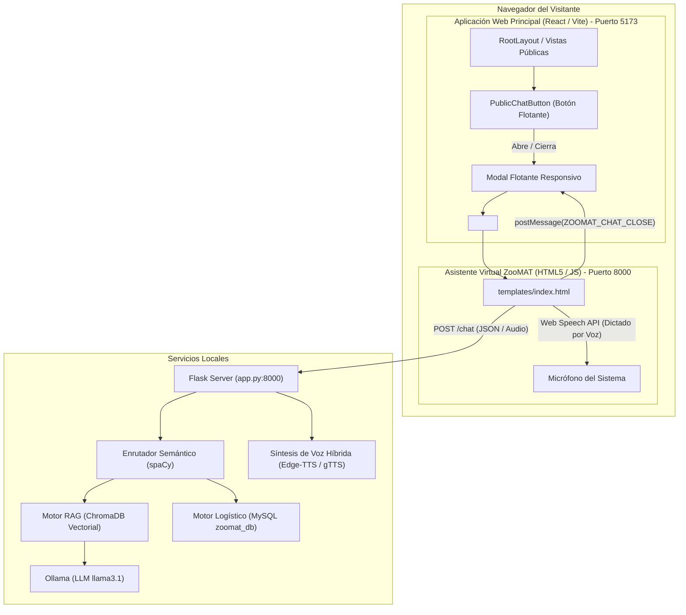

# Guía de Integración y Despliegue Local: Asistente Virtual ZooMAT en Pro_Zoo

Este documento describe la arquitectura desacoplada y los pasos necesarios para ejecutar simultáneamente el sitio web principal **Pro_Zoo** (desarrollado en React y TypeScript con Vite) y el **Asistente Virtual Inteligente ZooMAT** (desarrollado en Python con Flask, Llama 3.1, ChromaDB y MySQL).

---

## 1. Arquitectura del Sistema (Integración Desacoplada)

La solución adopta una **arquitectura basada en microfrontends desacoplados** mediante un contenedor `<iframe>` aislado y embebido dentro del componente React `PublicChatButton.tsx`.

### Diagrama de Comunicación y Flujo de Datos



### Ventajas de la Arquitectura Desacoplada
1. **Aislamiento Total de Dependencias:** React no compila código Python ni gestiona modelos de NLP; Flask opera con sus entornos virtuales y paquetes nativos sin mezclarse con Node.js.
2. **Cero Conflictos de CSS:** Los estilos de Tailwind v4 de la web principal no colisionan con las variables CSS ni las reglas personalizadas de madera rústica y dorado del chatbot.
3. **Persistencia de Conversación en Sesión:** El componente `PublicChatButton` implementa lazy loading inteligente (`hasOpened`). La primera vez que el usuario hace clic, el iframe se instancia; al minimizar o cerrar el modal, el iframe permanece vivo en memoria para que el visitante no pierda su conversación activa ni el historial de respuestas.

---

## 2. Requisitos Previos Indispensables

Antes de arrancar los servicios, asegúrate de contar con:

1. **Node.js (versión 18 o superior) y npm / pnpm:**
   - Para compilar y servir la aplicación React.
2. **Python 3.12 y Entorno Virtual (`venv`):**
   - Instalado en la carpeta `chatbot/` con todas las dependencias de `requirements.txt`.
3. **Servidor Local Ollama con Llama 3.1:**
   - Debe estar corriendo en segundo plano:
     ```bash
     ollama run llama3.1
     ```
   - Accesible en `http://localhost:11434`.
4. **Servidor MySQL Activo:**
   - Base de datos `zoomat_db` inicializada con las tablas y registros oficiales de logística (credenciales configuradas en `chatbot/.env`).

---

## 3. Guía de Ejecución Simultánea (Paso a Paso)

Para probar la integración completa en tu máquina de desarrollo, abre **dos terminales independientes**:

### Terminal A: Servidor Web Principal (React / Vite)

```bash
# Ubicado en la raíz del repositorio Pro_Zoo:
npm install        # (Solo la primera vez que se configure el proyecto)
npm run dev
```

* **URL del sitio web:** `http://localhost:5173` (o `http://localhost:3000` según configuración de Vite).
* En la esquina inferior derecha verás el botón flotante dorado con la etiqueta `chat •••`.

---

### Terminal B: Servidor del Asistente Virtual (Flask)

```bash
# Navega a la subcarpeta del chatbot:
cd chatbot

# Activar el entorno virtual:
# En Windows (PowerShell):
.\venv\Scripts\activate
# En Windows (CMD):
.\venv\Scripts\activate.bat
# En macOS o Linux:
source venv/bin/activate

# Iniciar la aplicación backend:
python app.py
```

* **URL del asistente:** `http://localhost:8000`
* El servidor de Flask levantará en `host='0.0.0.0', port=8000` sirviendo el endpoint `/chat`, los assets y la plantilla adaptada `index.html`.

---

## 4. Aspecto Crítico de Seguridad: El Atributo `allow="microphone"`

En `PublicChatButton.tsx`, la etiqueta `<iframe>` está declarada estrictamente de la siguiente manera:

```tsx
<iframe
  src="http://localhost:8000"
  width="100%"
  height="100%"
  frameBorder="0"
  style={{ border: "none", borderRadius: "inherit" }}
  allow="microphone"
  title="Asistente Virtual ZooMAT"
  className="w-full h-full block"
/>
```

### ¿Por qué es obligatorio `allow="microphone"`?
1. **Permissions-Policy del Navegador:** Los navegadores modernos (Google Chrome, Microsoft Edge, Safari) bloquean por defecto el acceso a hardware sensible (micrófono, cámara) cuando una página se carga dentro de un `<iframe>`, especialmente entre diferentes orígenes o puertos (`localhost:5173` embebiendo `localhost:8000`).
2. **Web Speech API:** Sin el atributo `allow="microphone"`, la invocación de `window.SpeechRecognition` o `window.webkitSpeechRecognition` falla de inmediato arrojando un error de seguridad `NotAllowedError` o silenciando la captura de audio.
3. Con este atributo habilitado, el navegador delega el permiso de captura de audio al iframe y el visitante puede pulsar el botón del micrófono para dictar sus preguntas en tiempo real con transcripción continua.

---

## 5. Controles de Accesibilidad e Interacción en el Frontend

La integración incluye 4 mecanismos coordinados para abrir y cerrar la ventana modal:

| Control | Acción | Comportamiento |
| :--- | :--- | :--- |
| **Botón Launcher Flotante** | Clic / Tap | Alterna el estado entre cerrado (`chat •••`) y abierto (`X` con animación de rotación). |
| **Tecla Escape (`Esc`)** | Pulsar tecla | Cierra fluidamente el modal sin perder el estado de la conversación. |
| **Botón de Cierre en Encabezado** | Clic en el botón `close` del chatbot | El iframe detecta que está embebido y notifica al padre mediante `postMessage({ type: 'ZOOMAT_CHAT_CLOSE' })`. |
| **Backdrop Traslúcido en Móviles** | Tap fuera de la tarjeta | En pantallas pequeñas (`< sm`), un overlay oscuro difuminado cierra la ventana al tocar el fondo. |

---

## 6. Verificación de Funcionamiento

1. Abre `http://localhost:5173` en tu navegador.
2. Haz clic en el botón flotante dorado `chat •••` en la esquina inferior derecha.
3. Verifica que la ventana modal se abra con bordes suaves, sombra profunda y el tema de madera rústica del ZooMAT.
4. Prueba hacer una consulta de texto (ej. *"¿Cuáles son los costos?"*) o toca un chip de sugerencia rápida.
5. Mantén presionado el botón del micrófono, habla en español o inglés y suéltalo para confirmar que la `Web Speech API` capture y envíe la pregunta sin bloqueos de permisos.
6. Cierra la ventana modal con la tecla `Esc`, el botón `X` o el botón del encabezado, y vuelve a abrirla para confirmar que el historial permanece intacto.

---

## 7. Despliegue en Producción (Linux + ISPConfig)

Para el despliegue nativo en servidores de producción bajo el dominio oficial `https://www.zoomat.chiapas.gob.mx/` (con servicios `systemd`, Gunicorn, Node.js y proxy inverso en ISPConfig):
* **Guía Completa de Despliegue Paso a Paso:** [deploy/linux/GUIA_DESPLIEGUE_LINUX_ISPCONFIG.md](deploy/linux/GUIA_DESPLIEGUE_LINUX_ISPCONFIG.md)
* **Script de Instalación Automatizada:** [deploy/linux/deploy_linux.sh](deploy/linux/deploy_linux.sh)
* **Especificación Técnica y Arquitectura:** [CONTEXTO_PROYECTO_PRO_ZOO.md](CONTEXTO_PROYECTO_PRO_ZOO.md)
