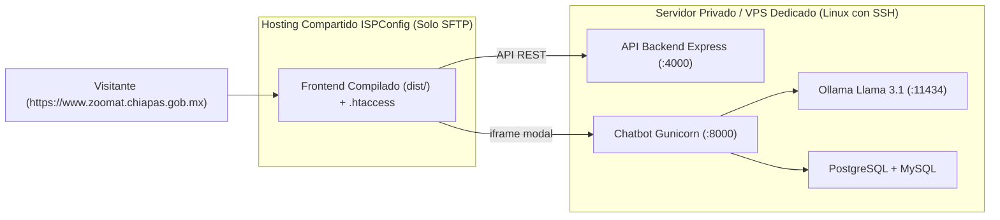

# Guía de Despliegue Nativo en Linux e ISPConfig
**Asistente Virtual ZooMAT & Plataforma Pro_Zoo**

> **Documento Oficial de Operaciones y DevOps**  
> **Dominio Objetivo:** `https://www.zoomat.chiapas.gob.mx/`  
> **Arquitectura:** Despliegue nativo en Linux (Debian 12 / Ubuntu 22.04 LTS o superior) gestionado con ISPConfig, systemd, Gunicorn, Node.js y Ollama.

---

## Índice General

1. [Diagnóstico Previo del Servidor (SSH y Recursos)](#1-diagnóstico-previo-del-servidor-ssh-y-recursos)
2. [Fase 1 — Prerrequisitos Manuales (Instalación del Administrador)](#2-fase-1--prerrequisitos-manuales-instalación-del-administrador)
3. [Fase 2 — Clonación y Configuración de Variables de Entorno (`.env`)](#3-fase-2--clonación-y-configuración-de-variables-de-entorno-env)
4. [Fase 3 — Ejecución del Script Automatizado (`deploy_linux.sh`)](#4-fase-3--ejecución-del-script-automatizado-deploy_linuxsh)
5. [Fase 4 — Pasos Finales Manuales (Superadmin y Proxy Inverso en ISPConfig)](#5-fase-4--pasos-finales-manuales-superadmin-y-proxy-inverso-en-ispconfig)
6. [Fase 5 — Verificación Post-Despliegue y Mantenimiento](#6-fase-5--verificación-post-despliegue-y-mantenimiento)
7. [Plan B — Escenario Híbrido (Si solo existe acceso SFTP sin SSH)](#7-plan-b--escenario-híbrido-si-solo-existe-acceso-sftp-sin-ssh)

---

## 1. Diagnóstico Previo del Servidor (SSH y Recursos)

Antes de iniciar la instalación, es obligatorio validar el acceso administrativo remoto y comprobar que el hardware cumpla con los requerimientos de inferencia de modelos de lenguaje (LLM) y almacenamiento vectorial.

### 1.1. Conexión por SSH
Accede al servidor con privilegios `root` o un usuario con permisos `sudo`:

```bash
ssh usuario@servidor.zoomat.chiapas.gob.mx
# O bien por dirección IP:
ssh root@200.x.x.x
```

### 1.2. Comando de Auditoría Rápida de Recursos
Ejecuta el siguiente bloque de comandos en la terminal para obtener una radiografía del entorno:

```bash
echo "=== SISTEMA OPERATIVO ===" && cat /etc/os-release | grep -E "PRETTY_NAME|VERSION="
echo "=== MEMORIA RAM ===" && free -h
echo "=== ALMACENAMIENTO EN DISCO ===" && df -h /
echo "=== NÚCLEOS DE CPU ===" && nproc
echo "=== GPU NVIDIA DISPONIBLE ===" && (nvidia-smi || echo "Modo CPU (sin GPU NVIDIA detectada)")
echo "=== SERVICIOS WEB Y BASES ACTIVAS ===" && systemctl is-active apache2 nginx mariadb mysql postgresql
```

### 1.3. Requisitos Recomendados del Sistema
* **Memoria RAM:** Mínimo **16 GB** (el modelo Ollama `llama3.1:latest` ocupa ~4.7 GB en RAM/VRAM; Gunicorn multi-hilo con spaCy y ChromaDB consume ~1.2 GB; Node.js Express ~200 MB; PostgreSQL y MySQL ~500 MB; el sistema operativo y buffers requieren ~4-8 GB de margen).
* **Almacenamiento:** Mínimo **15 GB SSD** libres (4.7 GB para el modelo Ollama, 1 GB para el acervo biológico y base ChromaDB, 3 GB para dependencias de Node.js y virtualenv de Python).
* **CPU:** Mínimo **4 núcleos físicos / 8 hilos** (Intel Xeon o AMD EPYC modernos). En modo CPU, una respuesta de Llama 3.1 8B tarda entre 2 y 4 segundos; con GPU NVIDIA compatible con CUDA la latencia baja a < 0.8 segundos.

### 1.4. Ajuste de Memoria para VM de 8 GB RAM (Perfil Linux 1.3: 2 vCPU · 8 GB RAM · 450 GB HDD)
Si el servidor es una Máquina Virtual con 8 GB de RAM y almacenamiento HDD (ej. catálogo Linux 1.3), el sistema está completamente optimizado para operar de forma ágil y estable aplicando los siguientes ajustes de arquitectura:

* **Modelo LLM de 3B Parámetros:** Se sustituye el modelo de 8B por un modelo compacto de 3B parámetros (`qwen2.5:3b` o `llama3.2:3b`), reduciendo drásticamente la huella del LLM a solo **~1.9 - 2.0 GB** en RAM.
* **Modelo Permanente en RAM (`OLLAMA_KEEP_ALIVE=-1`):** En discos mecánicos HDD, recargar el modelo desde disco causaría retrasos de 15 a 30 segundos por consulta. Manteniéndolo fijo en RAM, la inferencia responde de forma inmediata sin fricción de I/O de disco.
* **Swap de Seguridad (4 GB):** Se habilita un archivo `/swapfile` de 4 GB con `vm.swappiness=10` para blindar el sistema contra el *OOM Killer* ante picos de concurrencia, sin sobrecargar el HDD.
* **Gunicorn Concurrente para 2 vCPU:** Gunicorn se ejecuta con `1 worker` y `4 hilos` (`-w 1 --threads 4 --timeout 180`), compartiendo los ~1.2 GB de ChromaDB y spaCy entre hilos concurrentes.
* **Reindexación con Liberación de Recursos:** La rutina semanal `reindexar_semanal.sh` detiene temporalmente tanto `zoomat-chatbot.service` como `ollama.service`, liberando ~2.6 GB adicionales de RAM durante el proceso de ingesta de PyTorch y HuggingFace.

#### Ajustes Recomendados en Motores de Base de Datos para 8 GB RAM
Para evitar que las bases de datos compitan agresivamente por la memoria del sistema operativo y del LLM, se recomiendan los siguientes parámetros:

1. **PostgreSQL (`/etc/postgresql/16/main/postgresql.conf`):**
   ```ini
   shared_buffers = 256MB
   work_mem = 4MB
   maintenance_work_mem = 64MB
   effective_cache_size = 1GB
   ```
   Reinicia el servicio tras modificar: `sudo systemctl restart postgresql`

2. **MySQL / MariaDB (`/etc/mysql/my.cnf` o `/etc/mysql/mariadb.conf.d/50-server.cnf`):**
   ```ini
   [mysqld]
   innodb_buffer_pool_size = 128M
   max_connections = 50
   ```
   Reinicia el servicio tras modificar: `sudo systemctl restart mysql` o `sudo systemctl restart mariadb`

---

## 2. Fase 1 — Prerrequisitos Manuales (Instalación del Administrador)

Debes instalar manualmente los paquetes base del sistema, Node.js, Ollama y los motores de bases de datos antes de ejecutar el script de despliegue.

### 2.1. Paquetes Base del Sistema Operativo
Actualiza el gestor de paquetes e instala las herramientas esenciales de compilación y librerías de audio:

```bash
sudo apt update && sudo apt install -y \
    git \
    curl \
    build-essential \
    ffmpeg \
    python3.12 \
    python3.12-venv \
    python3.12-dev \
    python3-pip
```

### 2.2. Node.js 20 LTS (NodeSource)
Instala el runtime oficial de Node.js v20 para compilar el frontend React y ejecutar el backend Express:

```bash
curl -fsSL https://deb.nodesource.com/setup_20.x | sudo -E bash -
sudo apt install -y nodejs
node -v    # Debe reportar v20.x.x
npm -v     # Debe reportar v10.x.x
```

### 2.3. Motor de Inferencia Local Ollama (Llama 3.1)
Instala Ollama a nivel de sistema operativo y descarga el modelo oficial:

```bash
# 1. Instalar el daemon de Ollama
curl -fsSL https://ollama.com/install.sh | sh

# 2. Habilitar e iniciar el servicio systemd
sudo systemctl enable --now ollama

# 3. Descargar el modelo oficial seleccionado (llama3.2:3b para VM de 8 GB RAM o llama3.1 para 16 GB+)
ollama pull llama3.2:3b

# 4. Probar que responda en local
curl -X POST http://127.0.0.1:11434/api/generate \
  -H "Content-Type: application/json" \
  -d '{"model": "llama3.2:3b", "prompt": "hola", "stream": false}'
```

### 2.4. PostgreSQL 16+ (Base de Datos del Portal Web)
Instala PostgreSQL y crea la base de datos `pro_zoo` junto con su usuario:

```bash
sudo apt install -y postgresql postgresql-contrib
sudo systemctl enable --now postgresql

# Acceder al shell interactivo de PostgreSQL
sudo -u postgres psql
```

Dentro de `psql`, ejecuta:

```sql
CREATE DATABASE pro_zoo;
CREATE USER usr_prozoo_admin WITH ENCRYPTED PASSWORD 'TU_PASSWORD_PG_SEGURA';
GRANT ALL PRIVILEGES ON DATABASE pro_zoo TO usr_prozoo_admin;
\q
```

### 2.5. MySQL 8.0+ o MariaDB (Logística del Chatbot)
En servidores gestionados con ISPConfig, MySQL o MariaDB usualmente ya se encuentra activo. Verifica su estado y crea la base `zoomat_db`:

```bash
sudo mysql -u root -p
```

Dentro de MySQL/MariaDB, ejecuta:

```sql
CREATE DATABASE IF NOT EXISTS zoomat_db CHARACTER SET utf8mb4 COLLATE utf8mb4_unicode_ci;
CREATE USER IF NOT EXISTS 'zoomat_user'@'localhost' IDENTIFIED BY 'TU_PASSWORD_MYSQL_SEGURA';
GRANT ALL PRIVILEGES ON zoomat_db.* TO 'zoomat_user'@'localhost';
FLUSH PRIVILEGES;
EXIT;
```

---

## 3. Fase 2 — Clonación y Configuración de Variables de Entorno (`.env`)

El código fuente de la aplicación **no debe colocarse dentro de la carpeta pública de ISPConfig**, sino en un directorio aislado del sistema operativo para proteger el código del chatbot y del backend.

### 3.1. Clonar el Repositorio en `/opt/Pro_Zoo`
```bash
sudo mkdir -p /opt/Pro_Zoo
sudo git clone https://github.com/Emmax2s/Pro_Zoo.git /opt/Pro_Zoo
sudo chown -R root:root /opt/Pro_Zoo
cd /opt/Pro_Zoo
```

### 3.2. Generación de Claves Criptográficas Seguras
Ejecuta el script incluido para generar valores aleatorios de alta entropía para `ADMIN_API_KEY` y `JWT_SECRET`:

```bash
bash backend/generate-keys.sh
```

Copia las cadenas hexadecimales resultantes para usarlas en los archivos `.env`.

---

### 3.3. Configurar `/opt/Pro_Zoo/.env` (Frontend + Backend API + PostgreSQL)
Crea el archivo `/opt/Pro_Zoo/.env` pegando la siguiente estructura y sustituyendo los marcadores con tus contraseñas seguras:

```env
# ==============================================================================
# /opt/Pro_Zoo/.env - CONFIGURACIÓN DEL PORTAL Y BACKEND
# ==============================================================================

# ──────────────────────────────────────────────────────────────────────────────
# 1. FRONTEND WEB (Compilación de React con Vite)
# ──────────────────────────────────────────────────────────────────────────────
# Se deja vacío para que las peticiones se hagan relativas (/api/*) y el proxy inverso las enrute
VITE_API_BASE_URL=

# URL oficial del asistente virtual embebido en el iframe
VITE_CHATBOT_URL=https://www.zoomat.chiapas.gob.mx/chatbot/

# Clave de API para el panel de administración
VITE_ADMIN_API_KEY=PEGA_AQUI_ADMIN_API_KEY_GENERADA

# ──────────────────────────────────────────────────────────────────────────────
# 2. BACKEND API (Node.js Express)
# ──────────────────────────────────────────────────────────────────────────────
PORT=4000
NODE_ENV=production

# Base de datos PostgreSQL
POSTGRES_HOST=localhost
POSTGRES_PORT=5432
POSTGRES_USER=usr_prozoo_admin
POSTGRES_PASSWORD=TU_PASSWORD_PG_SEGURA
POSTGRES_DATABASE=pro_zoo
POSTGRES_SSL=false

# Claves de autenticación y seguridad
ADMIN_API_KEY=PEGA_AQUI_ADMIN_API_KEY_GENERADA
JWT_SECRET=PEGA_AQUI_JWT_SECRET_GENERADA

# Orígenes CORS autorizados (separados por coma)
CORS_ORIGIN=https://www.zoomat.chiapas.gob.mx,https://zoomat.chiapas.gob.mx

# URL pública del portal institucional
PUBLIC_APP_URL=https://www.zoomat.chiapas.gob.mx

# Servicio de Correo SMTP para recuperación de cuentas
SMTP_HOST=smtp.gmail.com
SMTP_PORT=465
SMTP_SECURE=true
SMTP_USER=notificaciones@zoomat.chiapas.gob.mx
SMTP_PASSWORD=TU_TOKEN_APLICACION_SMTP
MAIL_FROM=ZooMAT Oficial <noreply@zoomat.chiapas.gob.mx>
```

---

### 3.4. Configurar `/opt/Pro_Zoo/chatbot/.env` (Asistente Virtual + MySQL)
Crea el archivo `/opt/Pro_Zoo/chatbot/.env`:

```env
# ==============================================================================
# /opt/Pro_Zoo/chatbot/.env - CONFIGURACIÓN DEL ASISTENTE VIRTUAL
# ==============================================================================

# Puerto interno de escucha de Gunicorn / Flask
CHATBOT_PORT=8000
CHATBOT_DEBUG=false

# Orígenes web autorizados para interactuar con la API del bot
CORS_ORIGINS=https://www.zoomat.chiapas.gob.mx,https://zoomat.chiapas.gob.mx

# Directiva Content-Security-Policy para autorizar que el sitio web oficial lo embeba en iframe
FRAME_ANCESTORS=frame-ancestors 'self' https://www.zoomat.chiapas.gob.mx https://zoomat.chiapas.gob.mx http://localhost:* http://127.0.0.1:*

# Clave secreta para desencadenar la ingesta manual por endpoint
INGEST_SECRET=PEGA_AQUI_OTRA_CLAVE_ALEATORIA

# Conexión local al servidor Ollama
OLLAMA_HOST=127.0.0.1
OLLAMA_PORT=11434

# Modelo LLM seleccionado (optimizado para VM de 8 GB RAM: llama3.2:3b con 4096 tokens de contexto)
OLLAMA_MODEL=llama3.2:3b
OLLAMA_NUM_CTX=4096
OLLAMA_TIMEOUT=150

# Base de datos logística MySQL
DB_HOST=localhost
DB_PORT=3306
DB_USER=zoomat_user
DB_PASS=TU_PASSWORD_MYSQL_SEGURA
DB_NAME=zoomat_db
```

Protege los permisos de lectura de ambos archivos:

```bash
sudo chmod 600 /opt/Pro_Zoo/.env /opt/Pro_Zoo/chatbot/.env
```

---

## 4. Fase 3 — Ejecución del Script Automatizado (`deploy/linux/deploy_linux.sh`)

El repositorio incluye el script de instalación desatendida [deploy_linux.sh](file:///C:/Users/Angel/Desktop/Chatbot_Zoomat/Pro_zoo/deploy/linux/deploy_linux.sh) que automatiza la compilación del frontend, la inicialización de bases de datos, la ingesta vectorial de ChromaDB y el registro de los servicios `systemd`.

### 4.1. Localizar la Carpeta Web de ISPConfig
En el panel de control de ISPConfig, revisa la ruta raíz del sitio `zoomat.chiapas.gob.mx`. Usualmente tiene el formato:
`/var/www/clients/clientX/webY/web` o `/var/www/zoomat.chiapas.gob.mx/web`.

Abre el script con `nano`:

```bash
sudo nano /opt/Pro_Zoo/deploy/linux/deploy_linux.sh
```

Verifica o ajusta la línea 6 con tu ruta real:

```bash
ISPCONFIG_WEB_DIR="/var/www/clients/client1/web1/web"
```

Guarda con `Ctrl + O` y sal con `Ctrl + X`.

### 4.2. Ejecutar la Instalación Automatizada
Ejecuta el script con privilegios de superusuario:

```bash
sudo bash /opt/Pro_Zoo/deploy/linux/deploy_linux.sh
```

### 4.3. Resumen de Operaciones que Automatiza el Script
1. **Validación de Entorno:** Comprueba la existencia física de `/opt/Pro_Zoo/.env` y `/opt/Pro_Zoo/chatbot/.env`.
2. **Compilación de React con Vite:** Ejecuta `npm ci` y `npm run build`, empaquetando el frontend optimizado en `/opt/Pro_Zoo/dist/`.
3. **Publicación Web en ISPConfig:** Copia el contenido de `dist/` a la carpeta `web/` de ISPConfig e inyecta el archivo `.htaccess` configurado para manejar el enrutamiento SPA de React sin colisionar con `/api`, `/uploads` ni `/chatbot`.
4. **Inicialización de PostgreSQL:** Ejecuta `backend/db/init.sql` y `seed.sql`, otorgando privilegios sobre tablas y secuencias al usuario `usr_prozoo_admin`.
5. **Configuración de Python 3.12 y Chatbot:**
   - Genera el entorno virtual `venv`.
   - Instala dependencias protegidas (`click>=8.2.1`, `gunicorn`, `edge-tts`, etc.).
   - Descarga el modelo de spaCy en español `es_core_news_sm`.
   - Ejecuta la **primera ingesta vectorial** (`ingesta_datos.py`) procesando las 302 fichas biológicas e institucionales en ChromaDB.
   - Pre-renderiza los 6 audios rápidos estáticos (`costos.mp3`, `horarios.mp3`, `banos.mp3` y versiones en inglés).
6. **Servicios del Sistema (systemd):**
   - Registra y activa `prozoo-backend.service` (Node.js Express en `127.0.0.1:4000`).
   - Registra y activa `zoomat-chatbot.service` ejecutando Gunicorn con `-w 1 --threads 4 --timeout 180 -b 127.0.0.1:8000 app:app` (optimizado para 2 vCPU y 8 GB RAM, memoria compartida de ~1.2 GB y timeout tolerante a inferencia CPU).
7. **Tarea Programada Semanal (Cron):**
   - Genera el script `/opt/Pro_Zoo/chatbot/reindexar_semanal.sh` con control de excepciones `trap` que detiene temporalmente tanto `zoomat-chatbot.service` como `ollama.service` para liberar ~2.6 GB de RAM durante la ingesta vectorial, asegurando que ambos servicios se restablezcan automáticamente al concluir o ante cualquier fallo.
   - Registra la tarea en el `crontab` de root para ejecutarse cada lunes a las 02:00 AM.

---

## 5. Fase 4 — Pasos Finales Manuales (Superadmin y Proxy Inverso en ISPConfig)

### 5.1. Crear el Primer Superadministrador del CMS
Ejecuta el script interactivo en Node.js para registrar al usuario inicial en la tabla `admin_users` de PostgreSQL (con contraseña cifrada en Bcrypt):

```bash
cd /opt/Pro_Zoo
node backend/scripts/createAdmin.js
```

Introduce el nombre de usuario, correo electrónico y una contraseña segura de al menos 10 caracteres cuando el asistente lo solicite.

---

### 5.2. Configuración del Proxy Inverso en ISPConfig
Para que el dominio público `https://www.zoomat.chiapas.gob.mx/` comunique con el frontend estático, la API de Node.js y el Chatbot en Gunicorn, debes añadir directivas de proxy en ISPConfig.

Accede al panel: **ISPConfig → Sitios (Sites) → zoomat.chiapas.gob.mx → Opciones (Options) → Directivas de Apache / Nginx**.

#### Opción A: Servidor con Apache (Entorno más común en ISPConfig)
1. En la consola del servidor, asegúrate de que los módulos requeridos estén habilitados:
   ```bash
   sudo a2enmod proxy proxy_http headers rewrite
   sudo systemctl restart apache2
   ```
2. En ISPConfig, dentro de la caja de **Directivas de Apache**, pega el siguiente bloque:

```apache
# Aumentar timeout para soportar inferencia LLM en CPU (modelos 3B con timeout de 180s)
ProxyTimeout 180

# Proxy hacia la API REST del Backend (Express en puerto 4000)
ProxyPass /api http://127.0.0.1:4000/api
ProxyPassReverse /api http://127.0.0.1:4000/api

# Proxy hacia los archivos multimedia subidos
ProxyPass /uploads http://127.0.0.1:4000/uploads
ProxyPassReverse /uploads http://127.0.0.1:4000/uploads

# Proxy hacia el Asistente Virtual ZooMAT (Gunicorn en puerto 8000)
<Location /chatbot/>
    ProxyPass http://127.0.0.1:8000/
    ProxyPassReverse http://127.0.0.1:8000/
    RequestHeader set X-Forwarded-Proto "https"
    RequestHeader set X-Forwarded-Prefix "/chatbot"
</Location>
```

#### Opción B: Servidor con Nginx
Si el sitio web está configurado bajo Nginx puro en ISPConfig, pega el siguiente bloque dentro de **Directivas de Nginx**:

```nginx
proxy_read_timeout 180s;
proxy_connect_timeout 180s;

location /api/ {
    proxy_pass http://127.0.0.1:4000/api/;
    proxy_set_header Host $host;
    proxy_set_header X-Real-IP $remote_addr;
    proxy_set_header X-Forwarded-For $proxy_add_x_forwarded_for;
    proxy_set_header X-Forwarded-Proto $scheme;
}

location /uploads/ {
    proxy_pass http://127.0.0.1:4000/uploads/;
    proxy_set_header Host $host;
}

location /chatbot/ {
    proxy_pass http://127.0.0.1:8000/;
    proxy_set_header Host $host;
    proxy_set_header X-Real-IP $remote_addr;
    proxy_set_header X-Forwarded-For $proxy_add_x_forwarded_for;
    proxy_set_header X-Forwarded-Proto $scheme;
    proxy_set_header X-Forwarded-Prefix /chatbot;
}
```

Haz clic en **Guardar (Save)** en ISPConfig y espera de 1 a 2 minutos a que el panel regenere la configuración del host virtual.

---

## 6. Fase 5 — Verificación Post-Despliegue y Mantenimiento

### 6.1. Comprobación de Servicios del Sistema
Verifica que los tres servicios fundamentales estén en estado `active (running)`:

```bash
sudo systemctl status prozoo-backend zoomat-chatbot ollama
```

### 6.2. Pruebas Locales de Conectividad HTTP
Prueba que los puertos internos respondan adecuadamente:

```bash
# Probar Backend Express
curl -I http://127.0.0.1:4000/api/health

# Probar Chatbot Flask/Gunicorn
curl -I http://127.0.0.1:8000/
```

### 6.3. Verificación Integral de Lógica del Chatbot
Ejecuta la batería de 39 diagnósticos automáticos en la terminal:

```bash
cd /opt/Pro_Zoo/chatbot
./venv/bin/python verificar_sistema.py
```
*Debe reportar 39 pruebas aprobadas (100% de tasa de éxito).*

### 6.4. Prueba a Demanda de Reindexación Semanal
Simula la tarea programada que correrá los lunes a las 02:00 AM para verificar que el servicio se detenga, indexe y se reactive limpiamente:

```bash
sudo bash /opt/Pro_Zoo/chatbot/reindexar_semanal.sh
cat /opt/Pro_Zoo/chatbot/logs/ingesta_semanal.log
```

### 6.5. Validación Visual en el Navegador (Prueba en Vivo)
1. Ingresa a `https://www.zoomat.chiapas.gob.mx/`.
2. Haz clic en el botón flotante dorado con el logo del jaguar en la esquina inferior derecha.
3. Verifica que la ventana modal se abra con el tema de madera rústica y que no aparezcan errores de `CSP frame-ancestors` ni de `X-Frame-Options` en la consola de herramientas de desarrollo (`F12`).
4. Pulsa un botón de sugerencia rápida (ej. *"¿Cuáles son los costos?"*) y verifica la reproducción instantánea de audio.
5. Mantén presionado el botón del micrófono, habla en español o inglés y suéltalo para confirmar que la `Web Speech API` capture la voz gracias al atributo `allow="microphone"`.
6. Ingresa al panel de administración en `https://www.zoomat.chiapas.gob.mx/admin` e inicia sesión con el usuario superadmin creado en la Fase 4.

---

### 6.6. Comandos para Actualizaciones Futuras del Proyecto
Cuando se realicen mejoras en el repositorio de GitHub, actualiza el servidor con este procedimiento estándar:

```bash
cd /opt/Pro_Zoo
sudo git pull origin main

# Recompilar y publicar frontend
npm ci
npm run build
sudo cp -r dist/* /var/www/clients/client1/web1/web/

# Actualizar dependencias de Python si requirements.txt cambió
cd /opt/Pro_Zoo/chatbot
./venv/bin/pip install -r requirements.txt

# Reiniciar servicios de aplicación
sudo systemctl restart prozoo-backend.service zoomat-chatbot.service
```

### 6.7. Incorporación de Nuevas Fichas Biológicas al Chatbot
Para añadir nuevas especies nativas o documentos institucionales al asistente:
1. Copia los archivos `.pdf`, `.docx` o `.txt` dentro de la carpeta temática correspondiente en `/opt/Pro_Zoo/chatbot/documentos_zoomat/<Clase_o_Recinto>/`.
2. Espera a la madrugada del lunes para la ingesta automática, o fuerza la vectorización inmediata ejecutando:
   ```bash
   sudo bash /opt/Pro_Zoo/chatbot/reindexar_semanal.sh
   ```

---

## 7. Plan B — Escenario Híbrido (Si solo existe acceso SFTP sin SSH)

Si la infraestructura del gobierno del estado o los administradores de TI solo proveen una cuenta de **SFTP/FTP** hacia la carpeta `web/` de ISPConfig sin acceso a terminal SSH ni permisos `root`, **no será posible ejecutar Node.js, Gunicorn, PostgreSQL ni Ollama directamente en ese servidor web**.

En este escenario contingente, se adopta la arquitectura híbrida desacoplada:



### Pasos para Ejecutar el Plan B:
1. **Compilación Local del Frontend:**
   En tu equipo de desarrollo o en un servidor externo, configura el archivo `.env` apuntando al dominio o IP pública del servidor donde corre el backend y el chatbot:
   ```env
   VITE_API_BASE_URL=https://api.zoomat.chiapas.gob.mx
   VITE_CHATBOT_URL=https://chatbot.zoomat.chiapas.gob.mx/
   ```
   Compila con `npm run build`.
2. **Subida por SFTP (FileZilla):**
   Conéctate por SFTP a la cuenta provista y sube todo el contenido de la carpeta `dist/` junto con el archivo `.htaccess` directamente a la carpeta `/web/` de ISPConfig.
3. **Servidor Backend Dedicado:**
   En el servidor externo (VPS o máquina virtual dedicada con SSH), sigue las Fases 1, 2, 3 y 4 de esta guía para levantar `prozoo-backend.service`, `zoomat-chatbot.service` y `ollama.service`.
4. De esta manera, el portal oficial `https://www.zoomat.chiapas.gob.mx` sirve la interfaz estática desde el hosting del estado, mientras que el cómputo del chatbot inteligente y la base de datos se ejecutan de manera segura y escalable en el servidor dedicado.
